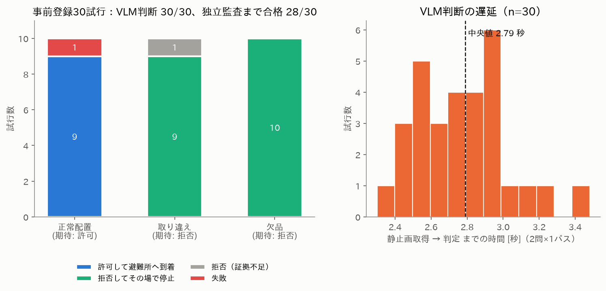

# RescueMind — 現地で「目で確かめてから」届ける災害物資ロボット

**Physical AI 応用1講座 最終課題** ｜ ROS 2 Jazzy × Gazebo Harmonic × ローカル VLM（Qwen2.5-VL-3B, Tesla V100）

> 「避難所Bに飲料水を届けて」と頼まれたロボットが物資拠点まで自律移動し、**その場で静止して搭載カメラで現物を確認**、
> ローカルVLMが「依頼された物資がある」と高い確信で一致したときだけ避難所Bへ向かう。
> 取り違えや欠品なら**動かずに止まり、人に判断を委ねる**。
> AIの判断と、ロボットが実際にどう動いたかを、Gazebo の物理真値・ROS bag・判断ログで第三者が検証できる形で記録する。


**提出物**：説明資料 [`docs/report/説明資料_PAI最終課題_tetsutetsu.pdf`](docs/report/説明資料_PAI最終課題_tetsutetsu.pdf) ／ デモ動画（YouTube、2分22秒、走行区間は2〜3倍速・AI判断は等速）／ 本リポジトリ


<!-- RESULTS:START -->
## 結果（事前登録した30試行・自律走行＋実撮影＋実推論）

| シーン（期待動作） | 許可→避難所Bに到着 | 拒否→拠点で停止 | 拒否（停止証拠が不合格） | 失敗 |
|---|---|---|---|---|
| 正常配置（許可） | **9** | 0 | 0 | 1 |
| 水と救急箱の取り違え（拒否） | 0 | **9** | 1 | 0 |
| 欠品・棚が空（拒否） | 0 | **10** | 0 | 0 |

* **VLMの判断（許可／拒否）は 30/30 で正解**：危険側の誤り（誤許可）**0件**、誤拒否 0件
* 判断に加えて Gazebo真値・ROS bag・時系列の**独立監査まで全て合格**：**28/30**
  * R001（swapped・medicine）：VLMは正しく拒否しロボットも停止したが、静止証拠の時刻整合チェックが3 ms差で不合格（修正済み）
  * R002（nominal・medicine）：VLMは正しく許可し避難所へ走行したが、車輪オドメトリの累積誤差（0.27 m）が監査上限0.25 mを超え、真値では目標点の0.34 m手前で停止
* VLM判断遅延（静止画取得→判断、2問）中央値 **2.79 秒**（最大 3.48 秒）、V100 FP16、VRAM 約8 GB
* VLM判断前のインフラ失敗による再試行：1件（台帳に全件記録）。3シーン×5反復は30個の独立シーンではない
* この評価（C）の前に、起動時の競合と孤立プロセスが原因で評価A・Bを中断（台帳は公開、詳細は [`docs/FINDINGS.md`](docs/FINDINGS.md) #12・#13）


<!-- RESULTS:END -->

## 何が新しいか

| 工夫 | 内容 |
|---|---|
| **閉集合の対数確率スコアリング** | VLMに文章を生成させず、3択の選択肢文字（A/B/C）の次トークン確率を1回の順伝播で読む。2問で**選択肢の順序を入れ替え**て文字位置バイアスを打ち消し、危険は別のYes/No質問で判定。解析不能な出力がゼロになり、判断に確信度が付く。 |
| **開発セットと評価の分離・事前登録** | プロンプトと閾値（0.50）は、視点をランダム化した開発画像48枚だけで決定し [`experiments/PREREGISTRATION_v33.md`](experiments/PREREGISTRATION_v33.md) に固定。その後、順序まで決めた30試行を一度だけ実行。 |
| **Gazebo真値による独立監査** | 制御器が使う車輪オドメトリではなく、シミュレータのモデル真値（`/ground_truth/odom`）で到着・停止・転倒・オドメトリ乖離を監査。これで**引継ぎ版の車輪軸バグ**（オドメトリ上は前進、実際は横滑り＋40°傾斜）を発見した。 |
| **独立速度ガード＋グラフ監視** | `/cmd_vel` の唯一の発行者は別プロセスのガード。センサー鮮度・前方距離・速度上限で10 Hz判定、異常はラッチ停止。DDSグラフで第2の発行者を検知したら非常停止。 |
| **「拒否」と「故障」を区別** | 拒否は「拒否イベント＋2.5秒の停止保持＋真値で拠点から動いていない＋bag確定」が揃って初めて成功扱い。VLMがエラーで止まっただけでは成功にしない。 |
| **sudo不要で再現** | Ubuntu 22.04 ホストでも Docker（ROS 2 Jazzy + Gazebo Harmonic + CUDA PyTorch）で動作。Gazebo は EGL ヘッドレス描画。 |

実際に動かして初めて分かった13件の問題と対策は [`docs/FINDINGS.md`](docs/FINDINGS.md) にまとめています。


## クイックスタート

```bash
# 0) 前提: NVIDIA GPU (V100で検証) + docker（nvidia-container-toolkit）。sudoは不要（dockerグループのみ）
bash docker/build.sh                                   # ROS 2 Jazzy + Gazebo Harmonic + PyTorch 2.5.1/cu121
# 1) モデル重みを一度だけ取得（以降の実行は HF_HUB_OFFLINE=1）
HF_HUB_OFFLINE=0 bash docker/run.sh python3 -c "from huggingface_hub import snapshot_download as s; s('Qwen/Qwen2.5-VL-3B-Instruct')"
# 2) テスト（514件。ROS/Gazebo不要の部分はDockerなしでも実行可）
bash docker/run.sh python3 -m unittest discover -s tests -q
# 3) 1回のAIミッション（Gazebo・ブリッジ・ガード・VLMを自動起動、証拠は outputs/runs/<run_id>/）
bash docker/run.sh python3 scripts/v32_orchestrate.py --run --scenario live --scene nominal \
     --capture-rosbag --instruction '避難所Bに飲料水を届けて'
#    --scene swapped / empty で取り違え・欠品（期待動作は「拒否して停止」）
# 4) 事前登録30試行の評価 → 図とレポート
bash docker/run.sh python3 scripts/run_campaign.py
bash docker/run.sh python3 scripts/export_evidence.py
bash docker/run.sh python3 scripts/make_figures.py
```

デモ動画用の俯瞰カメラ映像は `--film` で同時収録し、`scripts/make_demo_video.py --plan docs/video_plan.json` で合成します（映像はすべて Gazebo の実レンダリング。合成するのはログ由来の字幕・確率バー・真値軌跡のみ）。

## リポジトリ構成

| パス | 内容 |
|---|---|
| `ros/gazebo_waypoint_mission.py` | ミッション制御ノード（移動・照準・静止確認・新規フレーム取得・VLM確認・停止保持） |
| `ros/guarded_cmd_relay.py` / `rescuemind/velocity_relay.py` | 独立速度ガード |
| `ros/runtime_guard_graph_watch.py` | `/cmd_vel` 発行者のDDSグラフ監視 |
| `ros/odom_evidence_recorder.py` | 独立レコーダ（オドメトリ・速度・**Gazebo真値**） |
| `scripts/local_vlm_server.py` / `rescuemind/local_vision.py` | ローカルVLMサーバ（閉集合スコアリング）と判断ロジック |
| `scripts/v32_orchestrate.py` | スタック起動・準備確認・ミッション・証拠監査の統括 |
| `rescuemind/ground_truth_evidence.py` | Gazebo真値による到着・停止・転倒・乖離の監査 |
| `worlds/` | `rescuemind_test_arena.sdf`（原本）と自動生成した3シーン（正常／取り違え／欠品） |
| `experiments/` | 事前登録、30試行プロトコル、開発セット画像、結果台帳、各試行の証拠 |
| `docker/` | 再現環境（Dockerfile・実行ラッパー） |
| `docs/` | 図、[FINDINGS](docs/FINDINGS.md)、レポートPDF、動画の章立て、引継ぎ資料のアーカイブ |
| `scripts/make_figures.py` / `make_report.py` / `make_demo_video.py` | 図・PDF・動画をすべて結果ファイルから再生成（数値の手入力なし） |

`scripts/v0x〜v31_*` や `rescuemind/jev.py` などは引継ぎ前の開発履歴（旧クラウドAPI経路を含む）で、v3.3 の実行経路では使用していません（テストは維持）。

## 限界

物資の把持・運搬は行いません（現物確認と避難所への接近まで）。Nav2 ではなく既知配置のウェイポイント追従です。
評価は単純形状の小道具・3シーン・固定照明の反復であり、30試行は30個の独立シーンではありません。
ROSグラフ監視は認証機構ではなく、実機の安全認証を意味しません。

## ライセンス

MIT（`LICENSE`）。使用モデル：[Qwen/Qwen2.5-VL-3B-Instruct](https://huggingface.co/Qwen/Qwen2.5-VL-3B-Instruct)（Qwen Research License、重みは同梱しない）、
比較実験で [HuggingFaceTB/SmolVLM2-2.2B-Instruct](https://huggingface.co/HuggingFaceTB/SmolVLM2-2.2B-Instruct)（Apache-2.0）。
