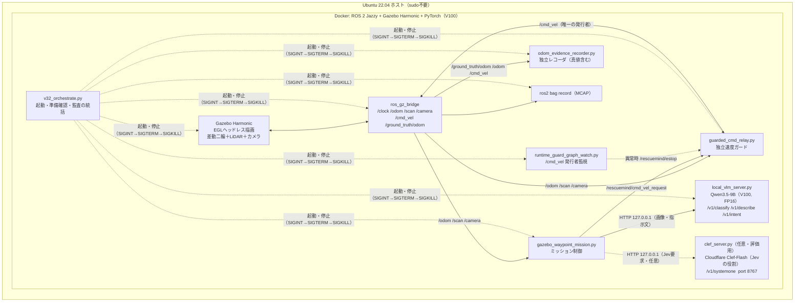
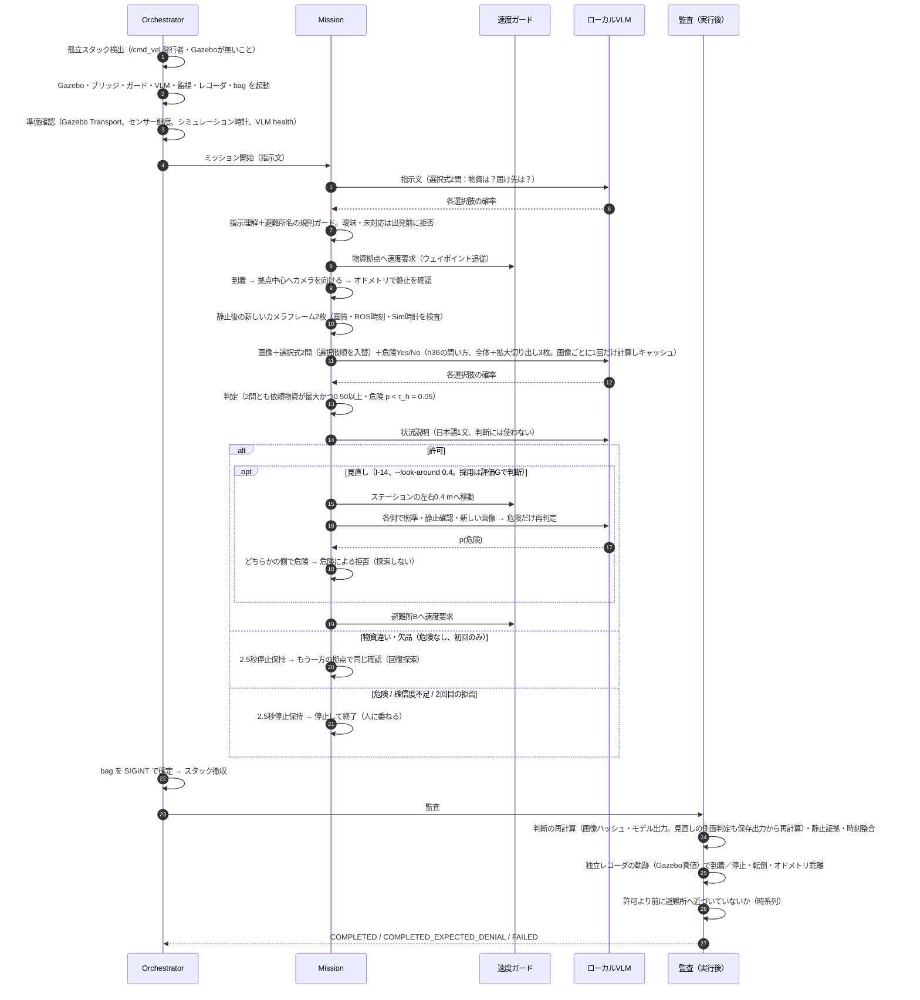
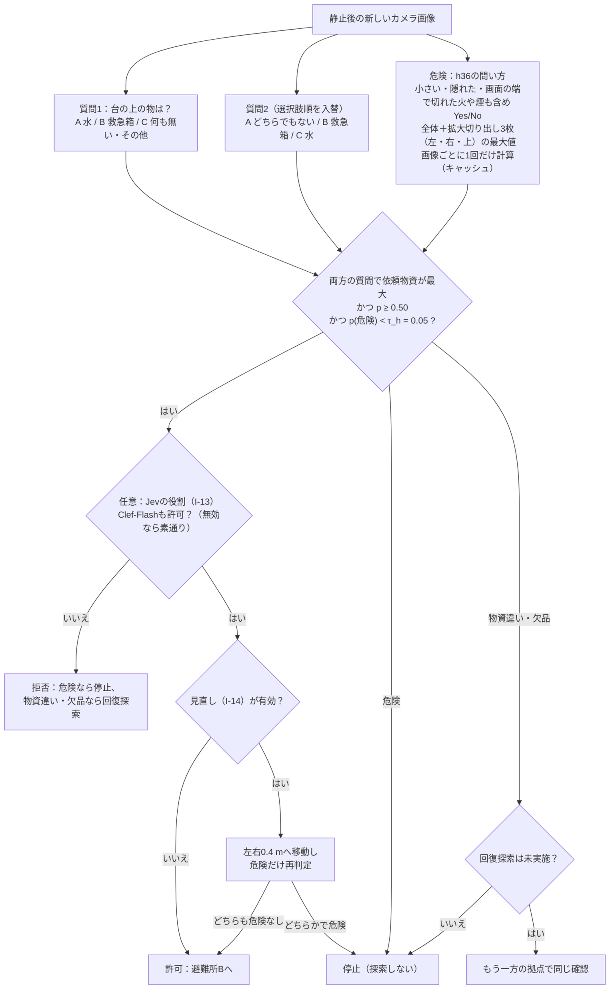

# RescueMind 全体アーキテクチャと処理フロー

このドキュメントは「何が・どの順で・どのプロセスで動き、何が証拠として残るか」を一枚で追えるようにまとめたもの。
改善の経緯は [`IMPROVEMENT_LOG.md`](IMPROVEMENT_LOG.md)、実行時に見つけた不具合は [`FINDINGS.md`](FINDINGS.md)。

## 1. システム構成（プロセスと通信）

* ミッションは速度を**要求**するだけで、車輪への指令（`/cmd_vel`）を出せるのは独立した速度ガードだけ。
* VLM はループバック（127.0.0.1）だけで待ち受け、クラウドAPIは一切使わない。
* Gazebo の真値（`/ground_truth/odom`）はレコーダと監査だけが使い、制御には使わない。
* **DDS の非同期送信（I-12）**：オーケストレータの既定は `--dds-mode async`。スタック全体に `RMW_FASTRTPS_PUBLICATION_MODE=ASYNCHRONOUS` を設定する。
  既定の同期送信では `publish()` 自体が 0.27〜0.33 秒ブロックすることがあり（10回中5回）、非同期では 0/10 だった。I-09 の「停止中は速度0を保持」も安全策として残している。
* **Clef-Flash（I-13、任意）**：Cloudflare の Clef-Flash を `scripts/clef_server.py`（Jev/SystemOne 互換 API、ループバックのポート 8767）でローカルに動かし、Jev の役割を担わせる構成。
  既定では起動しない（`--jev-local clef` で有効化）。Qwen3.5-9B と同時には約37 GB が必要で、V100 1台（32 GB）には載らないため、**評価した構成であって既定ではない**（第3節）。

## 2. 1回のミッションの流れ

## 3. 判定ロジック（VLMチェックポイント）

回答は文章を生成させず、次トークンの選択肢文字（A/B/C・Yes/No）の確率を1回の順伝播で読む（閉集合の対数確率スコアリング）。
解析不能な出力が起きず、判断に確信度が付く。閾値は開発用画像だけで決め、評価前に事前登録した。

### 3.1 危険の質問（I-10, I-11）
* **閾値は非対称**：τ_h = 0.05（物資側 τ_s = 0.50 は不変）。見逃しは致命的で、誤警報は「止まって人に委ねる」だけで済むため（I-10。火の無い開発画像164枚の p(危険) は最大 0.0007）。
* **問い方（h36）＋拡大切り出し（tiles）**：「小さい・一部隠れた・画面の端で切れた火や煙」を明示して尋ね、全体画像に加えて重なりのある拡大切り出し3枚（左・右・上）でも同じ質問をして最大値を取る（I-11）。評価Fの構成Bがこれにあたる。
  サーバの既定値は `h35`／`full`／τ_h=0.5 のままで、`--hazard-prompt h36 --hazard-views tiles --hazard-threshold 0.05` で指定する。
* 危険の質問は経路に依存しないので、**画像ごとに1回だけ計算**する（画像ハッシュでキャッシュ）。1回の確認でモデル呼び出しが1回減る。

### 3.2 横から見直す（I-14、v3.6 の既定）
* `--look-around 0.4`：正面の確認で許可したら、ステーションのウェイポイントから左右に 0.4 m 移動し（`schedule_look_around`）、そのたびに照準・静止確認・新しい画像の取得をやり直して**危険だけ**を再判定する（`look_around_peek`）。
* どちらかの側で危険を見たら、許可を危険による拒否に変える（`combine_with_look_around`）。**探索はしない**。横からの物資の判定は使わない（横からは物資が見えないことがあるため）。
* 根拠：評価Fで構成Bが見逃した火は、正面からは 1,100〜2,400 画素しか写らず、p(危険) が火の無い画像と重なった。同じ火が横の視点からは 4,600〜22,000 画素で見える（マスク画像での確認、D10）。
* 代償：配達1回あたり約+30秒。評価G（B と C の対比較、食い違い 10:0、p=0.002）で確認し、**v3.6 の既定**になった。

### 3.3 Jev の役割：Clef-Flash（I-13、任意・評価用）
* 当初計画の「異なる2つのAIで確認する」の復活。Cloudflare の Clef-Flash（Apache-2.0、Jev/SystemOne 互換）を `scripts/clef_server.py`（ポート 8767）でローカルに動かし、`combine_with_jev`（`rescuemind/local_vision.py`）で Qwen と合議する。
  **両方のモデルが許可したときだけ許可**し、どちらかが危険と判断したら拒否（探索なし）。物資違い・欠品は従来どおり回復探索の対象。
* **評価した構成であり、既定ではない**。Qwen3.5-9B と同時には約37 GB が必要で、V100 1台（32 GB）に載らないため、オフライン評価のみ（開発データ：誤許可 15/413、正しい許可 350/360、止めた火 196/211）。
* 質問の書き方に強く依存する：当初の Jev 要求（「通路」の安全を問う）では正しい配達の半分を拒否した（182/360）が、課題向けの質問にすると 350/360。
  T2 では**課題向けの質問を使った Clef-Flash 単独が v3.5 と同等**（1回の順伝播で約0.8秒）だった。

### 3.4 出動をまたぐ記憶（I-15、任意）
* `--memory-file`／`--memory-mode verified|naive|off`（`rescuemind/mission_memory.py`）。各出動の後、オーケストレータがロボット自身の観測（拠点ごとの物資の判定、危険を見た方向）を JSONL に追記する。真値は書かない。
* **記憶が決めるのは経路の順序と慎重さだけで、確認は省かない**（D13）：物資を見た拠点へ先に行く、最近危険を見た拠点では τ_h=0.01 にして火が見えた側から先に見る。監査は記憶で厳しくした判定を保存出力から再計算する。
* 比較対象の `naive` は記憶を信じて確認を省く。終了状態は `COMPLETED_MEMORY_TRUSTED`（配達）と `DENIED_BY_MEMORY`（拒否）で、評価Hで測るためだけに使う。

### 3.5 Jev の役割を実機で動かす（I-16、任意）
* `--jev-local clef --jev-schema task`：Clef-Flash（`scripts/clef_server.py`、ポート 8767）に課題向けの質問を送り、Qwen と**両方が許可したときだけ許可**する。`--jev-schema jev` は当初の Jev 要求。
* V100 1台に載せるため Qwen3.5-4B と組にする（約28 GB、D14）。Clef-Flash は Qwen3.5-9B の追加学習なので、2モデルは独立ではない（D11）。評価Jで測る。

## 4. 開発と評価の流れ（なぜ数値を信用できるか）

```mermaid
flowchart LR
  subgraph DEV["開発セット（選定・調整に使う）"]
    DEV1["v1 48枚（視点ランダム）"]
    DEV2["v2 128枚（照明・妨害物・火災）"]
    DH["DH 300枚（物資の陰の火）"]
    DH2["DH2 300枚（小さな初期火災。選定の前に追加）"]
  end
  DEV --> TUNE["プロンプト・閾値・構成の比較<br/>選定規則は先に固定"]
  TUNE --> PRE["事前登録<br/>PREREGISTRATION_*.md に固定"]
  PRE --> HELD["未使用テストセット（オフライン）<br/>T1 600枚 → T2 600枚"]
  PRE --> CAMP["閉ループ評価（試行ごとにスタックを新規起動）<br/>D → E → F（B対A） → G（見直しの有無）"]
  HELD --> CAMP
  CAMP --> LEDGER["台帳 campaign_ledger.jsonl<br/>失敗・中断も削除しない"]
  LEDGER --> EVID["証拠 evidence/&lt;run_id&gt;/<br/>判断画像・mission.json・真値軌跡・bag情報"]
  EVID --> GEN["図・README・レポートPDF・動画を自動生成<br/>（数値の手入力なし）"]
  HELD -. "結果で見つかった不具合は<br/>修正を追記（Amendment）として公開" .-> PRE
  CAMP -. "同上" .-> PRE
```

* 開発セット（v1、v2、DH、DH2）→ 未使用の T1／T2 → 閉ループ評価 D／E／F／G の順に進め、**すべて事前登録**する。結果を見たあとの変更は追記（Amendment）として公開し、採点前か後かを明記する。
* T1 は弱点（物資の陰の小さな火）の分析に使ったので、修正の確認には使えない。そこで同じ分布の新しい T2 を描画前に事前登録した（I-11, I-13）。
* 評価Fの結果（構成Bでも小さな火 7/13 を見逃し）から I-14 を設計し、新しい世界を使う評価G（B と B＋見直しの対比較）で確認する。

## 5. 主なファイル

| 層 | ファイル |
|---|---|
| 実行環境 | `docker/Dockerfile`（`STACK` 引数でモデル実行系を切替）, `docker/run.sh`, `docker/build.sh` |
| 世界 | `worlds/rescuemind_test_arena.sdf` → `scripts/v22_generate_scenes.py` で3シーン生成、`rescuemind/robust_scenes.py` で照明・妨害物・火災の派生 |
| ロボット制御 | `ros/gazebo_waypoint_mission.py`（`schedule_look_around`, `look_around_peek`）, `rescuemind/waypoint.py`, `rescuemind/camera_aim.py`, `rescuemind/stationary_gate.py` |
| 安全 | `ros/guarded_cmd_relay.py`, `rescuemind/velocity_relay.py`, `ros/runtime_guard_graph_watch.py`, `scripts/stack_quiescence.py` |
| AI | `scripts/local_vlm_server.py`, `rescuemind/local_vision.py`（`combine_with_jev`, `combine_with_look_around`, `verify_station_local`）, `rescuemind/mission_memory.py`（出動をまたぐ記憶）, `scripts/clef_server.py`（Jev の役割・任意）, `rescuemind/intent.py`, `rescuemind/intent_llm.py` |
| 監査 | `rescuemind/ground_truth_evidence.py`, `rescuemind/causal_evidence.py`, `rescuemind/negative_evidence.py`, `rescuemind/recovery_evidence.py`, `rescuemind/run_completion.py` |
| 評価 | `experiments/*`（事前登録・プロトコル・開発セット・台帳・証拠）, `scripts/run_campaign.py`, `scripts/*_eval.py` |
| 成果物生成 | `scripts/make_figures.py`, `scripts/make_report.py`, `scripts/make_video_plan.py`, `scripts/make_demo_video.py` |
