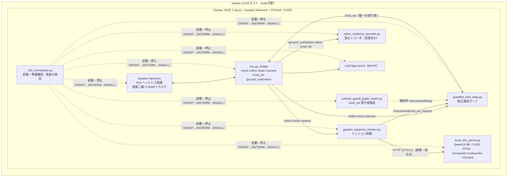
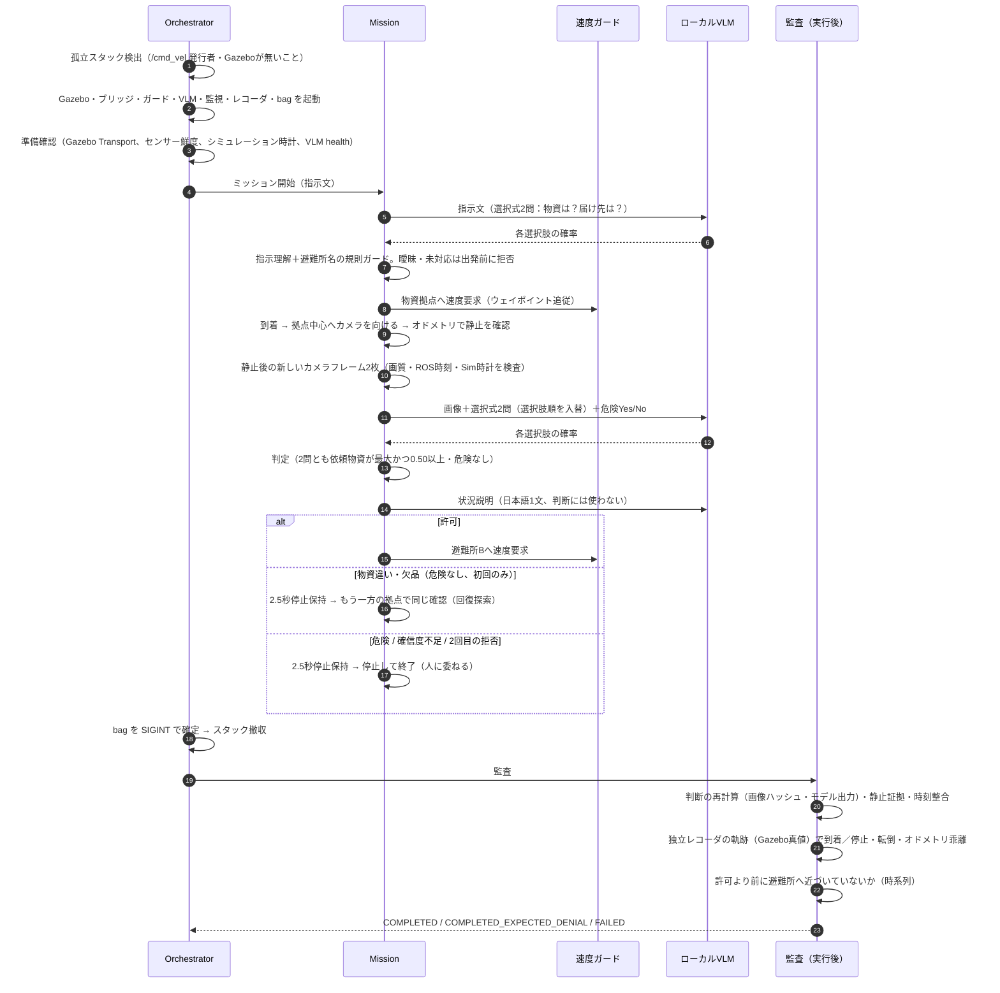
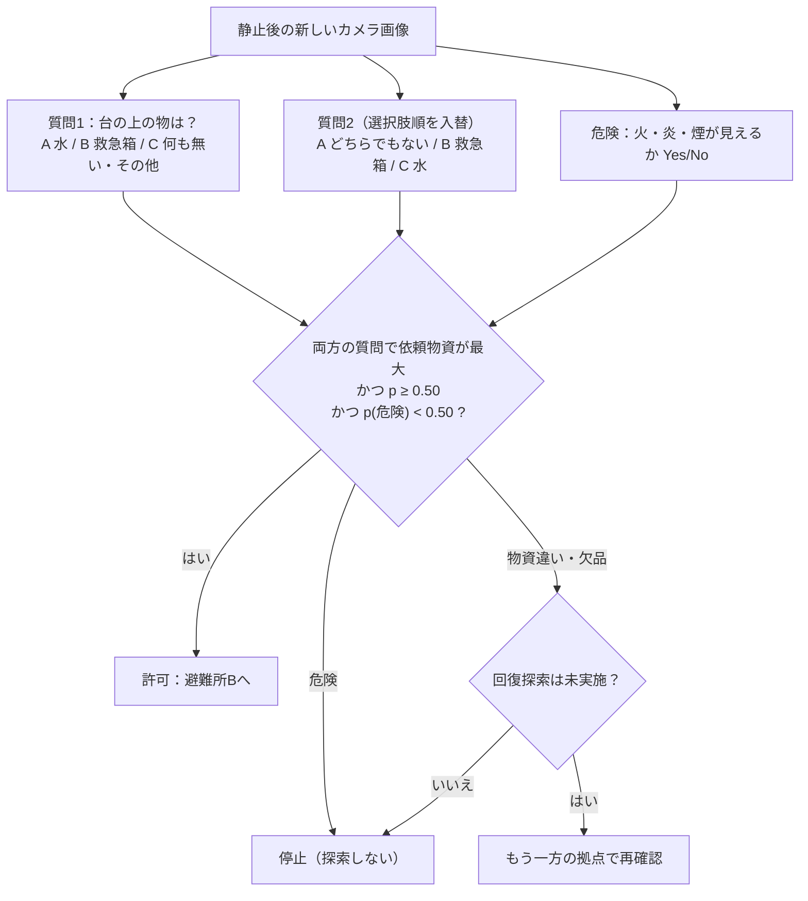
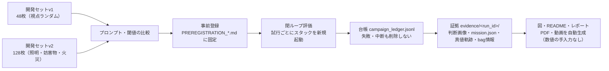

# RescueMind 全体アーキテクチャと処理フロー

このドキュメントは「何が・どの順で・どのプロセスで動き、何が証拠として残るか」を一枚で追えるようにまとめたもの。
改善の経緯は [`IMPROVEMENT_LOG.md`](IMPROVEMENT_LOG.md)、実行時に見つけた不具合は [`FINDINGS.md`](FINDINGS.md)。

## 1. システム構成（プロセスと通信）

* ミッションは速度を**要求**するだけで、車輪への指令（`/cmd_vel`）を出せるのは独立した速度ガードだけ。
* VLM はループバック（127.0.0.1）だけで待ち受け、クラウドAPIは一切使わない。
* Gazebo の真値（`/ground_truth/odom`）はレコーダと監査だけが使い、制御には使わない。

## 2. 1回のミッションの流れ

## 3. 判定ロジック（VLMチェックポイント）

回答は文章を生成させず、次トークンの選択肢文字（A/B/C・Yes/No）の確率を1回の順伝播で読む（閉集合の対数確率スコアリング）。
解析不能な出力が起きず、判断に確信度が付く。閾値は開発用画像だけで決め、評価前に事前登録した。

## 4. 開発と評価の流れ（なぜ数値を信用できるか）

## 5. 主なファイル

| 層 | ファイル |
|---|---|
| 実行環境 | `docker/Dockerfile`（`STACK` 引数でモデル実行系を切替）, `docker/run.sh`, `docker/build.sh` |
| 世界 | `worlds/rescuemind_test_arena.sdf` → `scripts/v22_generate_scenes.py` で3シーン生成、`rescuemind/robust_scenes.py` で照明・妨害物・火災の派生 |
| ロボット制御 | `ros/gazebo_waypoint_mission.py`, `rescuemind/waypoint.py`, `rescuemind/camera_aim.py`, `rescuemind/stationary_gate.py` |
| 安全 | `ros/guarded_cmd_relay.py`, `rescuemind/velocity_relay.py`, `ros/runtime_guard_graph_watch.py`, `scripts/stack_quiescence.py` |
| AI | `scripts/local_vlm_server.py`, `rescuemind/local_vision.py`, `rescuemind/intent.py`, `rescuemind/intent_llm.py` |
| 監査 | `rescuemind/ground_truth_evidence.py`, `rescuemind/causal_evidence.py`, `rescuemind/negative_evidence.py`, `rescuemind/recovery_evidence.py`, `rescuemind/run_completion.py` |
| 評価 | `experiments/*`（事前登録・プロトコル・開発セット・台帳・証拠）, `scripts/run_campaign.py`, `scripts/*_eval.py` |
| 成果物生成 | `scripts/make_figures.py`, `scripts/make_report.py`, `scripts/make_video_plan.py`, `scripts/make_demo_video.py` |
